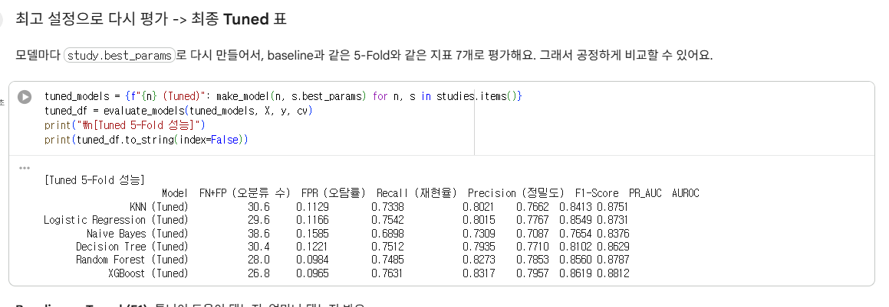
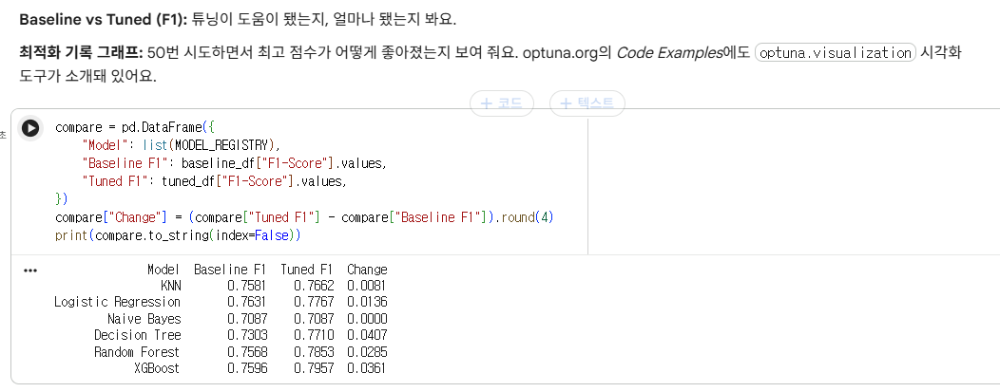
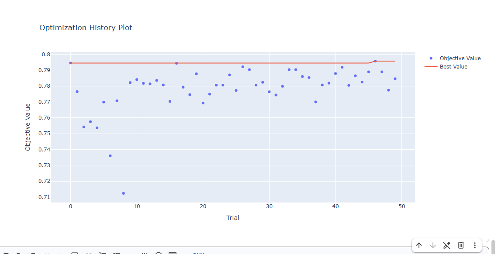

# 타이타닉 생존 예측: 교차검증 & Optuna 하이퍼파라미터 튜닝

타이타닉 승객 정보로 **생존 여부**를 예측하는 모델 6개를 만들고, **Optuna**로 모델마다 가장 좋은 설정값을 찾아 **5-Fold 교차검증**으로 비교한 프로젝트예요.

> 교수님이 주신 `term_project_optuna.py`를 Google Colab에서 실행하고, 단계별 설명을 덧붙인 노트북이에요.

## 바로 실행하기

## 사용한 모델 6개

KNN, Logistic Regression, Naive Bayes, Decision Tree, Random Forest, XGBoost

## 한눈에 보는 과정

1. **데이터 정리:** 이름에서 호칭(Mr, Mrs…)을 뽑아 `Title` 열을 만들어요.
2. **전처리 Pipeline:** 빈칸 채우기, 크기 맞추기, 글자를 숫자로 바꾸기를 **각 fold 안에서만** 계산해서 데이터 누수를 막아요.
3. **Baseline:** 튜닝 전, 기본 설정으로 6개 모델을 5-Fold로 평가해요.
4. **Optuna 튜닝:** 모델마다 50번 시도하고, 5-Fold F1 평균이 가장 큰 설정을 찾아요.
5. **재평가:** 찾은 최고 설정으로 다시 평가해서 지표 7개를 구해요.

### Optuna 3단계 ([optuna.org](https://optuna.org/) Quick Start)

| 단계 | 이 프로젝트에서 |
|---|---|
| 1. `objective` 함수 정의 | 설정값으로 모델을 만들고 5-Fold F1 평균을 반환 |
| 2. `trial.suggest_*`로 값 제안 | `n_neighbors`, `max_depth`, `learning_rate` 등을 범위 안에서 제안 |
| 3. `study` 만들고 `optimize` | `study.optimize(objective, n_trials=50)` |

## 결과

### Tuned 5-Fold 성능

| Model | FN+FP | FPR | Recall | Precision | F1-Score | PR_AUC | AUROC |
|---|---|---|---|---|---|---|---|
| KNN (Tuned) | 30.6 | 0.1129 | 0.7338 | 0.8021 | 0.7662 | 0.8413 | 0.8751 |
| Logistic Regression (Tuned) | 29.6 | 0.1166 | 0.7542 | 0.8015 | 0.7767 | 0.8549 | 0.8731 |
| Naive Bayes (Tuned) | 38.6 | 0.1585 | 0.6898 | 0.7309 | 0.7087 | 0.7654 | 0.8376 |
| Decision Tree (Tuned) | 30.4 | 0.1221 | 0.7512 | 0.7935 | 0.7710 | 0.8102 | 0.8629 |
| Random Forest (Tuned) | 28.0 | 0.0984 | 0.7485 | 0.8273 | 0.7853 | 0.8560 | 0.8787 |
| **XGBoost (Tuned)** | **26.8** | **0.0965** | **0.7631** | **0.8317** | **0.7957** | **0.8619** | **0.8812** |

**XGBoost가 7개 지표 모두에서 가장 좋았어요.** Naive Bayes가 가장 낮았어요. (FN+FP, FPR은 작을수록, 나머지는 클수록 좋아요.)

### 튜닝 전(Baseline) vs 튜닝 후(Tuned): F1

튜닝 후 5개 모델의 F1이 올랐고 **결정트리가 +0.0407로 가장 많이** 올랐어요. 튜닝 전에는 로지스틱 회귀가 1등이었는데, 튜닝 후에는 XGBoost가 1등이 됐어요.

### Optuna 최적화 기록 (XGBoost, 50 trials)

파란 점은 trial마다의 F1, 빨간 선은 지금까지의 최고 점수예요.

## 참고

- Optuna 공식 홈페이지: https://optuna.org/
- 교수님 유튜브(교차검증 01, 02, 03): https://www.youtube.com/@ancestor9
