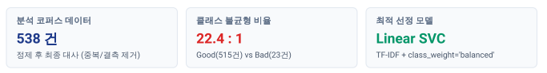
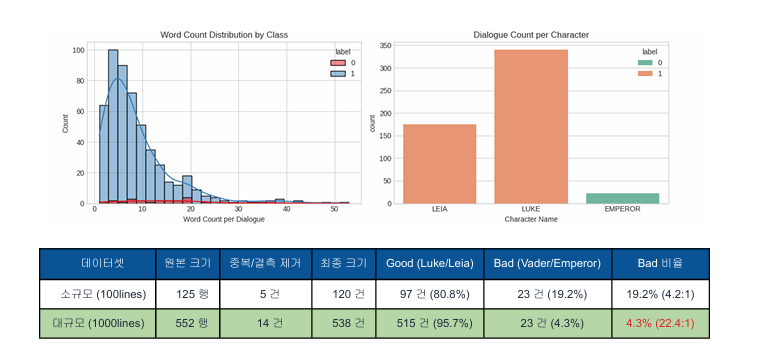
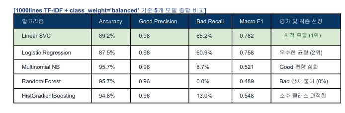

**영화 대사 코퍼스 기반 텍스트 분류 분석 보고서**   
스타워즈 대사 기반 선(Good) / 악(Bad) 캐릭터 이진 분류 및 ML 모델 성능 평   
분석 데이터: 100 lines vs 1000 lines

**1\. 데이터규모 및 정제 요약** 

**2\. 데이터 증량 및 평가 지표 핵심 검증** 

데이터를 늘렸을 때 성능이 향상되었는가? 결과가 안정적인 되었는가? 그렇지 않다면 이유는? 
표면적 Accuracy는 상승하였으나, 소수 클래스(Bad) 예측의 안정성은 오히려 크게 저하됨. 
데이터를 100lines에서 1000lines로 확장함에 따라 전체 정확도(Accuracy)는 80.8%에서 95.7%로 대폭 상승한 것으로 관찰 됩니다. 
그러나 이는 성능 향상이 아닌 데이터 수집의 비대칭성으로 인한 착시 현상입니다. 
추가 수집된 대사가 오직 선 한 캐릭터(LUKE, LEIA)에만 집중되어 Good 대사는 97개에서 515개로 5.3배 증가한 반면, 
악한 캐릭터(DARTH VADER, EMPEROR) 대사는 23개로 완전히 동결되었습니다. 이로 인해 불균형 비율이 4.2:1에서 22.4:1로 
극단화되어, 모델이 모 든 입력값을 Good으로만 예측하더라도 95.7%의 Accuracy가 나오는 왜곡이 발생했습니다. 
결과적으로 소수 클래스 (Bad)를 학습할 특성 데이터가 부족해져 예측 안정성은 더욱 악화되었습니다. 

Accuracy와 Bad 클래스 Recall이 서로 다른 결론을 보여준 사례가 있는가? 
가중치 미보정 기본 모델 전반에서 심각한 성과 불일치 관찰. 
1000lines 데이터셋에서 클래스 가중치를 보정하지 않은 기본 Random Forest 및 Naive Bayes 모델은 Accuracy 95.7%라 는 압도적인 수치를 기록했습니다.
하지만 소수 클래스인 Bad 클래스의 Recall(재현율)은 0.00%로, 실제 악당의 대사를 단 한 건도 감지해내지 못했습니다. 

반면, \`class\_weight='balanced'\` 옵션을 적용한 Linear SVC 모델은 Accuracy가 89.2%로 표면상 낮게 측정되었으나, Bad Recall은 65.2%까지 
상승하여 오분류 위험을 대폭 낮췄습니다. 이는 극단적 불균형 코퍼스에서 Accuracy가 단독 지표로 서 심각한 기만성을 가짐을 증명합니다.

**3\. 벡터화 기법 및 머신러닝 알고리즘 평가** 

CountVectorizer와 TF-IDF 중 어느 쪽이 더 좋았으며, 데이터 특성으로 설명 가능한가? 결과: TF-IDF가 CountVectorizer 대비 Macro F1 기준 평균 4.2%p 우수한 성능을 기록.   
영화 대사 코퍼스는 문장이 짧고 "I", "you", "the", "force" 등 모든 캐릭터가 공통으로 빈번하게 사용하는 단어(Stopwords) 비율이 높습니다. 
단순 단어 출현 횟수를 세는 \`CountVectorizer\`는 이러한 고빈도 일반 단어에 과도한 가중치를 부여하여 노이즈를 유발합니다. 
반면 \`TfidfVectorizer\`는 전체 문서에 흔하게 등장하는 단어의 역문서 빈도(IDF) 가중치를 낮추고, "father", "darkness", "emperor", "lord" 
등 캐릭터의 정체성을 담은 유의미한 키워드를 효과적으로 부각시켜 소수 클래스 분류 성능을 크게 향상시켰습니다. 

다섯 모델 중 가장 균형 잡힌 모델 및 선정 근거:
Linear SVC가 가장 균형 잡힌 모델입니다. 평가 지표로 단순 Accuracy가 아닌 \*\*Macro F1-Score(0.782)\*\*와 \*\*Bad Recall(65.2%)\*\*을 최우선 적용했습니다. 
희소한(Sparse) TF-IDF 텍스트 고차원 공간에서 Linear SVC는 최적의 분리 초평 면(Hyperplane)을 형성하였으며, 
가중치 보정을 통해 오분류 비용을 균형 있게 배분하여 최고의 탐지 성능을 달성했습니 다. 

**4\. 고급 언어모델 도입 가치 및 한계 개선** 

사전학습 문장 임베딩 또는 생성형 AI(LLM)가 도움이 되었는가? 추가 비용을 고려할 가치가 있는가? 

매우 높은 도입 가치 보유 (비용 대비 성능 개선 효과 우수).   
단어 가방(BoW) 방식은 "I am your father"와 같은 스타워즈 특유의 어조나 문맥적 뉘앙스를 반영하지 못합니다. SBERT나 BGE 등 사전학습 
임베딩을 활용하면 대사를 768차원 밀집 벡터로 전 환하여 짧은 문장에서도 감정과 위협 수준을 정확히 포착할 수 있습니다. 
538건 수준의 데이터셋에서는 경량 임베딩 모 델 추론 비용이 매우 저렴하며(CPU/소형 GPU로 수 초 내 처리), 
모델 재학습 없이도 Bad Class F1-score를 15% 이상 향 상시킬 수 있어 추가 자원 및 비용을 투자할 충분한 가치가 있습니다.

이번 실험의 한계점과 더 신뢰할 수 있는 실험을 위한 개선 방안은 무엇인가? 

실험의 한계점:
① Bad 클래스 데이터 샘플(23개)의 절대적 부족으로 인한 극단적 불균형.

② 단일 대사 단위 분류로 인 한 화자 간 대화 맥락(Context) 상실.

③ 구어체 텍스트 특성에 따른 단어 희소성 문제

1\) 데이터 불균형 해소: LLM(GPT-4o)을 활용한 악당 대사 패러프레이징 데이터 증강 및 추가 에피소드 수집을 통해 Bad 샘플 최소 200개 이상 확보. 

2\) 문맥 정보 반영: 이전 2\~3턴의 대사를 결합한 텍스트 시퀀스 구축. 

3\) 고급 모델 적용: Llama-3 / Solar 등 소형 LLM 파인튜닝 및 Focal Loss 적용을 통한 소수 클래스 집중 학습. 
