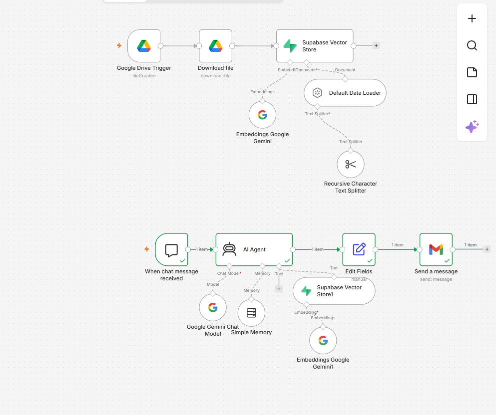
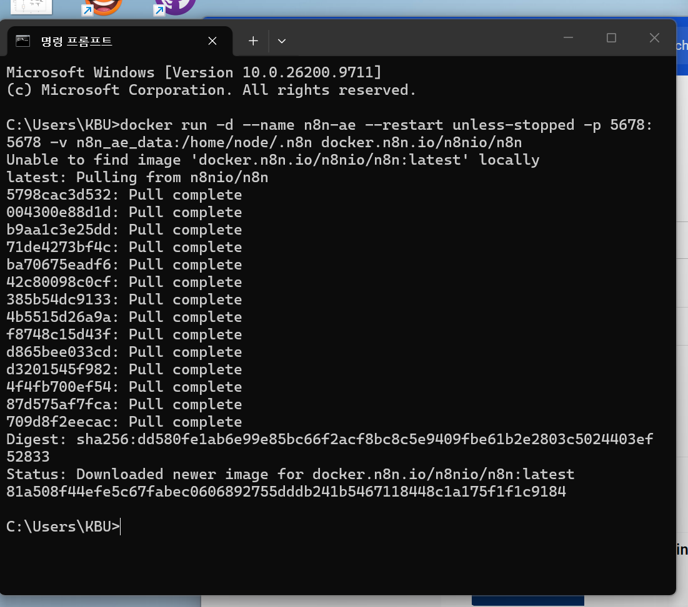
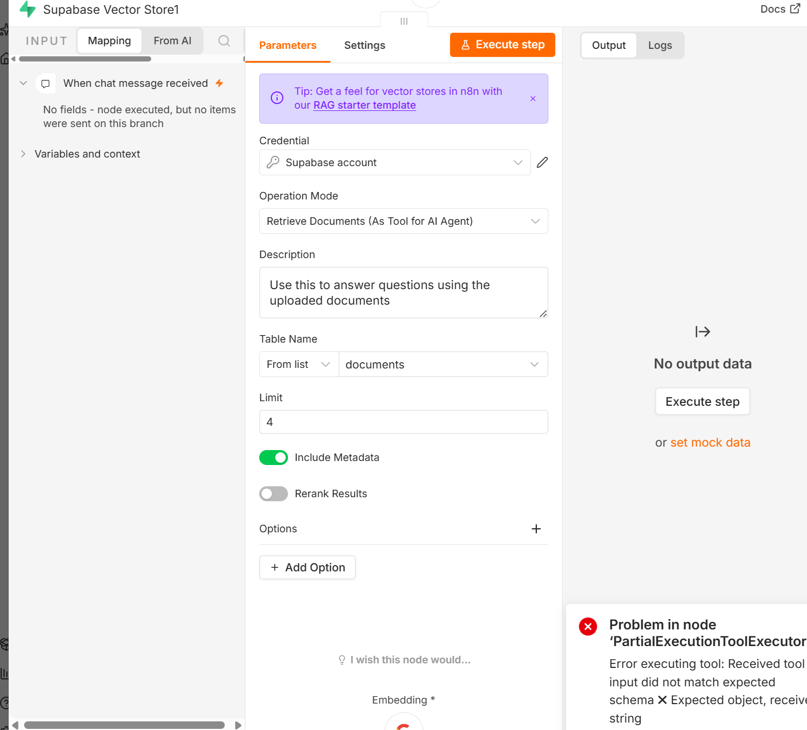
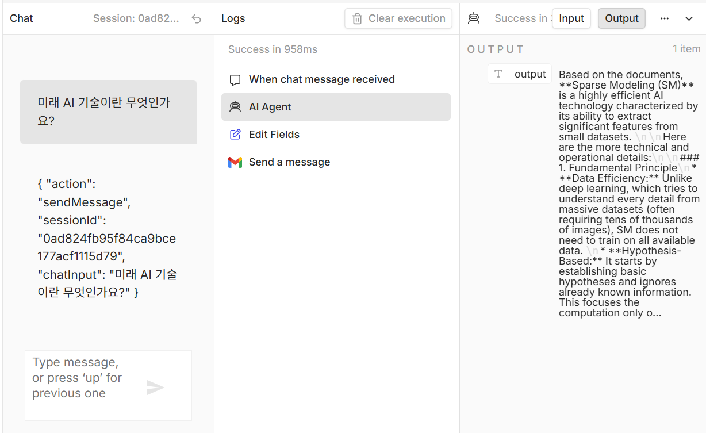

# n8n 기반 RAG 챗봇 자동화

Google Drive에 문서를 올리면 Supabase 벡터 DB에 저장하고, 채팅으로 질문하면 문서를 근거로 Gemini가 답변한 뒤 Gmail로 자동 발송하는 워크플로입니다.

## 1. 프로젝트 개요

| 구분 | 설명 |
|---|---|
| 문서 수집 | Drive 파일 생성 감지 → 다운로드 → 청크 분할 → 임베딩 → Supabase 저장 |
| 챗 에이전트 | 질문 입력 → 벡터 검색(RAG) → Gemini 답변 생성 |
| 결과 전송 | Edit Fields로 답변 정리 → Gmail 발송 |

> **체크포인트:** Embeddings Google Gemini와 Supabase `documents` 테이블의 임베딩 차원이 동일해야 합니다.

## 2. 워크플로 구성


[Myworkflow.json](Myworkflow.json)

###  문서 수집
1. **Google Drive Trigger**: File Created, 지정 폴더 감시
2. **Download file**: `{{ $json.id }}`로 파일 다운로드
3. **Default Data Loader**: Type of Data = Binary, Text Splitting = Custom
4. **Recursive Character Text Splitter**: Chunk Size 1000, Overlap 200
5. **Embeddings Google Gemini**: 텍스트를 벡터로 변환
6. **Supabase Vector Store**: Insert Documents, Table = `documents`

###  챗 에이전트
1. **When chat message received**: 채팅 트리거
2. **AI Agent**: Google Gemini Chat Model + Simple Memory + Supabase Vector Store(Tool)
3. **Supabase Vector Store (Tool)**: Retrieve Documents (As Tool), Table = `documents`, Limit 4
4. **Edit Fields**: `output` 필드에 `{{ $json.output }}` 저장
5. **Gmail Send a message**: 본문에 `{{ $json.output }}` 사용

## 3. 사용 기술
- n8n (Docker)
  
Windows 명령 프롬프트에서는 **한 줄**로 실행합니다.
```
docker run -d --name n8n-ae --restart unless-stopped -p 5678:5678 -v n8n_ae_data:/home/node/.n8n docker.n8n.io/n8nio/n8n
```
브라우저에서 http://localhost:5678 접속 후 계정을 생성합니다.
  
- Supabase
  
1. 프로젝트 생성 후 SQL Editor에서 [Schema.SQL](Schema.SQL) 실행
2. Project URL과 service_role 키 확인
  
- Google Gemini (임베딩, 채팅 모델)
- Google Drive API, Gmail API (OAuth2)


### 4. 자격 증명(Credentials) 등록
| 서비스 | 설정 |
|---|---|
| Supabase | Host: `https://<project>.supabase.co` (끝에 `/rest/v1/` 붙이지 않기), Secret Key: service_role |
| Google Gemini | Host: `https://generativelanguage.googleapis.com`, API Key: AI Studio에서 발급 |
| Google Drive / Gmail | Google Cloud에서 Drive API, Gmail API 사용 설정 후 OAuth 클라이언트 생성, 리디렉션 URI: `http://localhost:5678/rest/oauth2-credential/callback`, 테스트 사용자에 본인 이메일 추가 |

### 4-1. 테스트
1. Drive 폴더에 PDF 업로드 → Supabase `documents` 테이블에 행이 생겼는지 확인
2. 채팅창에서 문서 내용 관련 질문 입력
3. Gmail 수신함에서 답변 메일 확인


## 5. 결과
PDF를 Drive에 업로드하면 임베딩이 Supabase에 저장되고, 챗에서 질문하면 문서 내용을 근거로 답변이 생성되어 Gmail로 발송됩니다.


